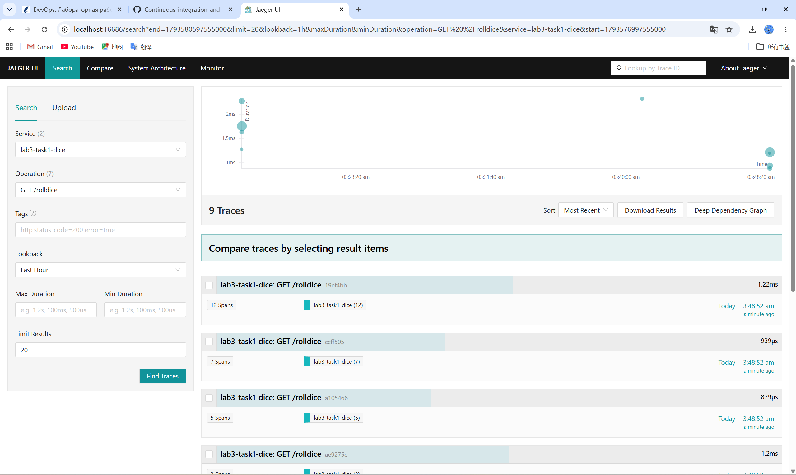
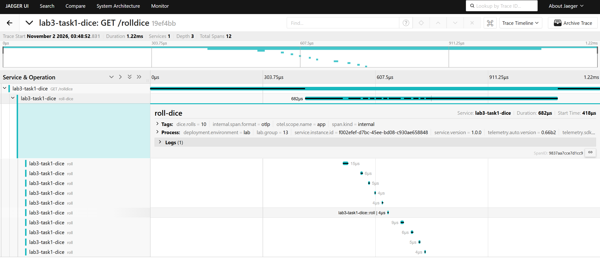

# Overview

Report on LabRabota3 — Мониторинг в распределённых системах (НИиСПО, ФПМИ БГУ).

Лабораторная работа №3, группа 13, задание 1: подключение библиотек OpenTelemetry
и настройка трассировки Flask-приложения с визуализацией в Jaeger.

| Задание | Каталог | Содержание |
|---------|---------|------------|
| Задание 1 | [`task1/`](task1/) | Flask-приложение с инструментацией OTel, Dockerfile, docker-compose (приложение + Jaeger) |
| Задание 2 | — | не выполняется для группы 13 |
| Задание 3 | — | не выполняется для группы 13 |

# Usage

To check, please, preview report by [docs/report.md](docs/report.md) and source files
in `task1/`.

Запуск стенда:

```bash
cd task1
docker compose up -d --build
python scripts/load.py
```

Jaeger UI: <http://localhost:16686> → Service `lab3-task1-dice` → Find Traces.

# Screenshots

Список трассировок в Jaeger UI (9 трассировок, 3…12 спанов в каждой):



Детали трассировки `19ef4bb`: `GET /rolldice` → `roll-dice` → 10 × `roll`,
теги спана `dice.rolls=10` и ресурсные атрибуты процесса:



# Author

Цзэн Яосинь (ZENG YAOXIN), студент группы 13, ФПМИ БГУ.

# Additional Notes

Отчёт: [docs/report.md](docs/report.md) — цель работы, вариант задания, код приложений
и конфигурационных файлов, результаты тестов, ответы на контрольные вопросы.
# Continuous-integration-and-software-build_LAB3
