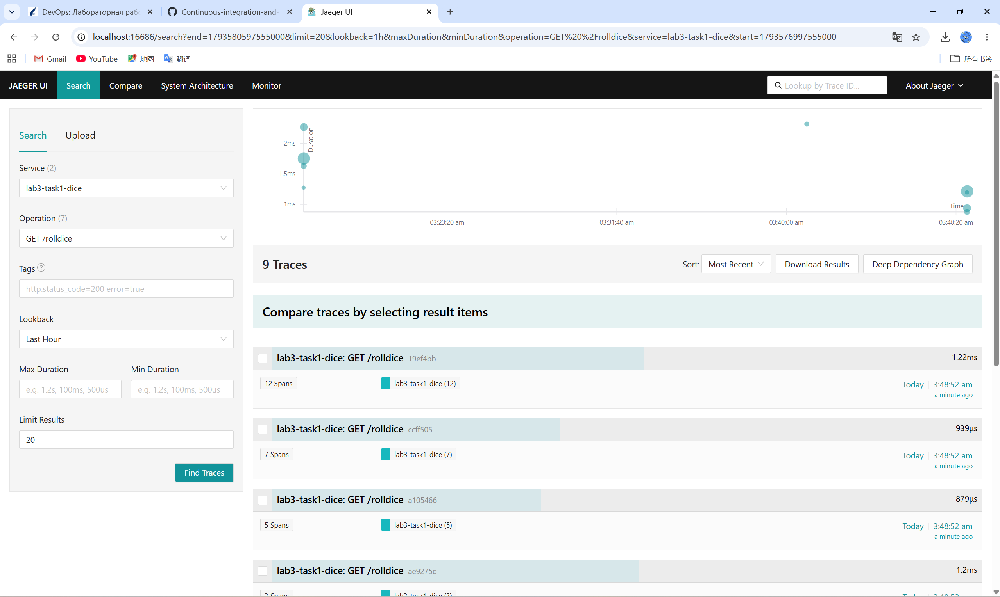
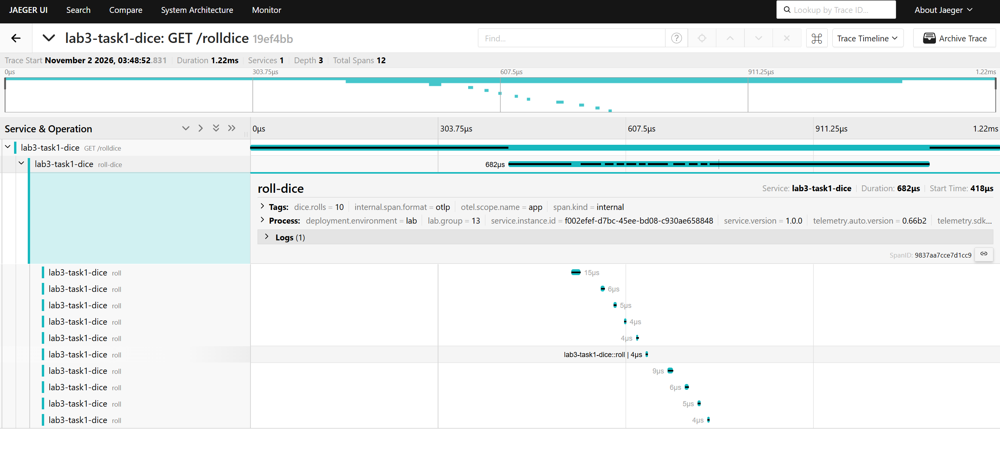

# Отчёт по лабораторной работе №3

## Мониторинг в распределённых системах

| Параметр | Значение |
|----------|----------|
| Дисциплина | «Непрерывное интегрирование и сборка программного обеспечения» |
| Выполнил | Цзэн Яосинь (ZENG YAOXIN) |
| Группа | 13 |
| Задание | 1 — подключение инструментов и библиотек OpenTelemetry и настройка трассировки приложения |

---

## 1. Цель работы

Изучить средства мониторинга для сбора и обработки телеметрии приложений и настроить систему,
в которой данные трассировок собираются для микросервисного приложения на языке Python.
В рамках задания 1 требуется:

1. подготовить приложение на Python к анализу трассировки с помощью Jaeger;
2. упаковать приложение в образ Docker и поднять контейнер средствами Docker Compose;
3. обеспечить экспортирование телеметрии (трассировок) в Jaeger.

## 2. Вариант задания

Согласно критериям оценивания, группа 13 выполняет **только задание 1**.
Вариант — базовое приложение на Flask из официальной документации OpenTelemetry
(«Getting Started by Example», эндпоинт `/rolldice`), дополненное ручной инструментацией:
вложенными спанами, атрибутами, событиями и обработкой ошибок.

Состав стенда:

| Компонент | Версия | Назначение |
|-----------|--------|------------|
| Python | 3.12 (образ `python:3.12-slim`) | среда выполнения |
| Flask | 3.x | веб-приложение |
| OpenTelemetry SDK / API | 1.3x + 0.6xb | генерация трассировок |
| `opentelemetry-instrumentation-flask` | автоматическая инструментация | спан на HTTP-запрос |
| Jaeger all-in-one | 1.62.0 | приём (OTLP), хранение и визуализация трассировок |
| Docker / Docker Compose | 29.x / v5.x | сборка образа и запуск стенда |

## 3. Ход выполнения работы

### Шаг 1. Создание приложения на Python

Создано Flask-приложение `app.py` с четырьмя эндпоинтами (`/`, `/rolldice`, `/error`, `/health`).
Каждый бросок кубика оформляется отдельным дочерним спаном `roll`, а весь обработчик —
спаном `roll-dice` с атрибутом `dice.rolls` и событием `dice.rolled`.
Эндпоинт `/error` демонстрирует спан со статусом `ERROR` и записанным исключением.

### Шаг 2. Установка измерительных инструментов и библиотек OpenTelemetry

В `requirements.txt` подключены `opentelemetry-distro` (метапакет: API, SDK,
`opentelemetry-instrument`, `opentelemetry-bootstrap`) и `opentelemetry-exporter-otlp`.
В `Dockerfile` дополнительно выполняется `opentelemetry-bootstrap -a install`, который
автоматически доустанавливает пакеты инструментации под текущие зависимости приложения
(в данном случае `opentelemetry-instrumentation-flask`, `-wsgi`, `-requests`, `-urllib3` и др.).

### Шаг 3. Подключение библиотек для трассировки приложения

Приложение запускается через агент автоинструментации:

```
opentelemetry-instrument flask --app app run --host 0.0.0.0 --port 8080
```

`opentelemetry-instrument` читает переменные окружения `OTEL_*`, создаёт `TracerProvider`,
регистрирует OTLP-экспортёр и включает автоинструментацию Flask (спаны `GET /rolldice` и т. д.).
Параметры экспорта задаются в `docker-compose.yaml`, поэтому код приложения не зависит
от инфраструктуры.

### Шаг 4. Развертывание Jaeger

Используется контейнер `jaegertracing/all-in-one:1.62.0` с включённым OTLP-приёмником
(`COLLECTOR_OTLP_ENABLED=true`). Порты: `16686` — веб-интерфейс, `4317` — OTLP/gRPC, `4318` — OTLP/HTTP.

### Шаг 5. Упаковка приложения в Docker-контейнер

Образ собирается по `Dockerfile` (многослойная сборка: сначала зависимости, затем исходный код),
стенд поднимается командой `docker compose up -d --build`.

## 4. Код приложений и конфигурационных файлов

### 4.1. `app.py`

```python
import logging
import random

from flask import Flask, jsonify, request
from opentelemetry import trace
from opentelemetry.trace import Status, StatusCode

app = Flask(__name__)
logger = logging.getLogger(__name__)

tracer = trace.get_tracer(__name__)


@app.route("/")
def index():
    return jsonify(
        service="lab3-task1-dice",
        endpoints={
            "/rolldice": "бросить кубик (параметр rolls=N)",
            "/error": "сгенерировать ошибку для проверки статуса спана",
            "/health": "проверка работоспособности",
        },
    )


@app.route("/rolldice")
def roll_dice():
    rolls = request.args.get("rolls", default=1, type=int)
    rolls = max(1, min(rolls, 10))

    with tracer.start_as_current_span("roll-dice") as span:
        span.set_attribute("dice.rolls", rolls)
        results = [roll(i) for i in range(rolls)]
        span.add_event("dice.rolled", {"dice.results": str(results)})
        logger.info("Брошено кубиков: %s, результат: %s", rolls, results)
        return jsonify(results=results, total=sum(results))


def roll(index: int) -> int:
    with tracer.start_as_current_span("roll") as span:
        value = random.randint(1, 6)
        span.set_attribute("dice.index", index)
        span.set_attribute("dice.value", value)
        return value


@app.route("/error")
def error():
    with tracer.start_as_current_span("failing-operation") as span:
        try:
            raise RuntimeError("демонстрационная ошибка для Jaeger")
        except RuntimeError as exc:
            span.record_exception(exc)
            span.set_status(Status(StatusCode.ERROR, str(exc)))
            logger.exception("Ошибка в /error")
            return jsonify(error=str(exc)), 500


@app.route("/health")
def health():
    return jsonify(status="ok")
```

### 4.2. `requirements.txt`

```
Flask>=3.0,<4.0
opentelemetry-distro>=0.48b0
opentelemetry-exporter-otlp>=1.27.0
```

### 4.3. `Dockerfile`

```dockerfile
FROM python:3.12-slim

WORKDIR /app

ENV PYTHONDONTWRITEBYTECODE=1 \
    PYTHONUNBUFFERED=1 \
    PIP_NO_CACHE_DIR=1 \
    OTEL_SERVICE_NAME=lab3-task1-dice

COPY requirements.txt ./

RUN pip install --no-cache-dir --upgrade pip \
 && pip install --no-cache-dir -r requirements.txt \
 && opentelemetry-bootstrap -a install

COPY app.py ./

EXPOSE 8080

CMD ["opentelemetry-instrument", \
     "flask", "--app", "app", "run", \
     "--host", "0.0.0.0", "--port", "8080"]
```

### 4.4. `docker-compose.yaml`

```yaml
name: lab3-task1

services:
  jaeger:
    image: jaegertracing/all-in-one:1.62.0
    container_name: lab3-task1-jaeger
    environment:
      COLLECTOR_OTLP_ENABLED: "true"
    ports:
      - "16686:16686"
      - "4317:4317"
      - "4318:4318"
    restart: unless-stopped

  app:
    build:
      context: .
      dockerfile: Dockerfile
    image: lab3-task1-app:1.0.0
    container_name: lab3-task1-app
    environment:
      OTEL_SERVICE_NAME: lab3-task1-dice
      OTEL_RESOURCE_ATTRIBUTES: deployment.environment=lab,service.version=1.0.0,lab.group=13
      OTEL_TRACES_EXPORTER: otlp
      OTEL_METRICS_EXPORTER: none
      OTEL_LOGS_EXPORTER: none
      OTEL_EXPORTER_OTLP_PROTOCOL: grpc
      OTEL_EXPORTER_OTLP_ENDPOINT: http://jaeger:4317
      OTEL_EXPORTER_OTLP_INSECURE: "true"
      OTEL_PYTHON_LOG_CORRELATION: "true"
    ports:
      - "8080:8080"
    depends_on:
      jaeger:
        condition: service_started
    healthcheck:
      test:
        - CMD
        - python
        - -c
        - "import urllib.request; urllib.request.urlopen('http://localhost:8080/health')"
      interval: 15s
      timeout: 5s
      retries: 5
      start_period: 20s
    restart: unless-stopped
```

### 4.5. Значения переменных окружения

| Переменная | Значение | Назначение |
|------------|----------|------------|
| `OTEL_SERVICE_NAME` | `lab3-task1-dice` | имя сервиса в Jaeger |
| `OTEL_RESOURCE_ATTRIBUTES` | `deployment.environment=lab,service.version=1.0.0,lab.group=13` | ресурсные атрибуты |
| `OTEL_TRACES_EXPORTER` | `otlp` | экспортёр трассировок |
| `OTEL_METRICS_EXPORTER` | `none` | метрики отключены (задание 2) |
| `OTEL_LOGS_EXPORTER` | `none` | журналы отключены (задание 3) |
| `OTEL_EXPORTER_OTLP_PROTOCOL` | `grpc` | протокол OTLP |
| `OTEL_EXPORTER_OTLP_ENDPOINT` | `http://jaeger:4317` | адрес приёмника |
| `OTEL_PYTHON_LOG_CORRELATION` | `true` | корреляция журналов и трассировок |

## 5. Результаты тестов

### 5.1. Запуск стенда

```
$ docker compose up -d --build
$ docker compose ps
NAME                IMAGE                             STATUS                    PORTS
lab3-task1-app      lab3-task1-app:1.0.0              Up (healthy)              0.0.0.0:8080->8080/tcp
lab3-task1-jaeger   jaegertracing/all-in-one:1.62.0   Up                        16686, 4317-4318
```

### 5.2. Проверка эндпоинтов (скрипт `scripts/load.py`)

| Запрос | Ответ | Результат |
|--------|-------|-----------|
| `GET /health` | `200` `{"status":"ok"}` | OK |
| `GET /` | `200` | список эндпоинтов |
| `GET /rolldice?rolls=1` | `200` `{"results":[3],"total":3}` | OK |
| `GET /rolldice?rolls=3` | `200` `{"results":[2,1,5],"total":8}` | OK |
| `GET /rolldice?rolls=5` | `200` `{"results":[4,3,1,4,6],"total":18}` | OK |
| `GET /rolldice?rolls=10` | `200` `{"results":[3,6,1,3,2,4,1,6,2,4],"total":32}` | OK |
| `GET /error` | `500` | ожидаемая ошибка |

### 5.3. Проверка регистрации сервиса в Jaeger

```
$ curl -s http://localhost:16686/api/operations?service=lab3-task1-dice
["failing-operation", "GET /health", "GET /rolldice", "GET /", "roll", "roll-dice", "GET /error"]
```

Зарегистрированы 7 операций: 4 автоматические (server-спаны) и 3 ручные (internal-спаны).

### 5.4. Структура одной трассировки (`GET /rolldice?rolls=10`, 12 спанов)

Трассировка `19ef4bb8bd80f7526986c911b8123345`, общая длительность 1.22 мс:

| Спан | Длительность | Родитель | Атрибуты |
|------|--------------|----------|----------|
| `GET /rolldice` | 1215 µs | — (корень) | — (автоинструментация Flask) |
| `roll-dice` | 682 µs | `GET /rolldice` | `dice.rolls=10`, событие `dice.rolled` |
| `roll` | 15 µs | `roll-dice` | `dice.index=0, dice.value=3` |
| `roll` | 6 µs | `roll-dice` | `dice.index=1, dice.value=5` |
| `roll` | 5 µs | `roll-dice` | `dice.index=2, dice.value=4` |
| … (всего 10 дочерних спанов `roll`) | 4–9 µs | `roll-dice` | `dice.index`, `dice.value` |

Иерархия спанов корректна: HTTP-спан → бизнес-спан → N дочерних операций,
`traceID` общий для всех 12 спанов. В спане `roll-dice` зафиксировано событие
`dice.rolled` с результатами серии бросков `[3, 5, 4, 1, 2, 1, 4, 5, 5, 3]`,
а в Process-атрибутах видны ресурсные метки `deployment.environment=lab`,
`lab.group=13`, `service.version=1.0.0`.

### 5.5. Проверка обработки ошибок

```
failing-operation | error=true | otel.status_code=ERROR | msg=демонстрационная ошибка для Jaeger
  event: exception.type=RuntimeError, exception.message=..., exception.stacktrace=...
GET /error         | error=true | otel.status_code=ERROR
```

### 5.6. Визуализация в Jaeger UI



*Рис. 1. Поиск трассировок в Jaeger UI: сервис `lab3-task1-dice`, операция `GET /rolldice`,
за последний час найдено 9 трассировок. Количество спанов в трассировке (12, 7, 5, 3)
соответствует параметру `rolls` запроса, длительность — от 0.88 мс до 2.32 мс.*



*Рис. 2. Детали трассировки `19ef4bb`: 1 сервис, глубина 3, всего 12 спанов;
видна вложенность `GET /rolldice` → `roll-dice` → 10 × `roll`. Для спана `roll-dice`
раскрыты теги (`dice.rolls=10`, `otel.scope.name=app`, `span.kind=internal`),
ресурсные атрибуты процесса и событие `dice.rolled` в разделе Logs.*

## 6. Ответы на контрольные вопросы

**1. Что такое OpenTelemetry? Атрибуты, события, контекст, журналы, трассировки, показатели?**
OpenTelemetry (OTel) — открытая платформа наблюдаемости (проект CNCF), предоставляющая
спецификацию, API, SDK и инструменты для генерации, сбора и экспорта телеметрии
(трассировок, метрик, журналов) независимо от вендора. Основные понятия:
*атрибуты* (attributes) — пары «ключ–значение» на спане, метрике или ресурсе, описывающие
контекст (`http.method`, `dice.rolls`); *событие* (event/span event) — отметка времени
с именем и атрибутами внутри спана (исключение, лог-запись); *контекст* (context) —
объект, переносящий `trace_id`, `span_id` и baggage между вызовами и сервисами;
*журналы* (logs) — записи о событиях с меткой времени; *трассировки* (traces) — дерево
спанов, описывающее путь запроса; *показатели* (metrics) — числовые агрегаты состояния
системы во времени.

**2. Что такое наблюдаемость? Надёжность и показатели?**
Наблюдаемость (observability) — свойство системы, позволяющее по внешним данным (телеметрии)
судить о её внутреннем состоянии и отвечать на вопросы «что произошло» и «почему» без
развёртывания нового кода. Надёжность (reliability) — способность системы выполнять функцию
без отказов в течение заданного времени; описывается SLI (измеряемые показатели: доля
успешных запросов, задержка p95/p99, насыщение), SLO (целевые значения SLI) и бюджетом
ошибок. Наблюдаемость — инструмент контроля надёжности: без метрик и трассировок нельзя
измерить SLI и заметить деградацию.

**3. Что такое трассировка? Распределённая трассировка? Как собирать и какие проблемы?**
Трассировка — запись пути выполнения операции в виде дерева спанов с длительностями.
Распределённая трассировка описывает один запрос, проходящий через несколько сервисов:
спаны связываются через `trace_id` и `parent_span_id`. Сбор: инструментация (авто/ручная)
→ экспорт по OTLP → бэкенд (Jaeger, Tempo) → визуализация. Проблемы распределённой
архитектуры: проброс контекста между разнородными транспортами (HTTP, gRPC, очереди);
разные форматы и вендоры; большой объём данных и необходимость сэмплирования; рассинхронизация
часов между узлами; отсутствие инструментации в сторонних компонентах; накладные расходы
на передачу и хранение.

**4. Сигналы OpenTelemetry: трассировки, метрики, логи?**
Три основных сигнала: *traces* — причинно-связанные спаны (путь и задержки запроса);
*metrics* — агрегированные числовые значения (счётчики, гистограммы) с временными рядами;
*logs* — дискретные записи событий. Дополнительно существует *baggage* — набор
распространяемых между сервисами пар «ключ–значение», не входящий в трассировку.
Все сигналы объединяются общим ресурсом (Resource) и корреляцией `trace_id`.

**5. Инструменты OpenTelemetry: автоматические, ручные, библиотеки?**
*Автоматическая инструментация* — агент (`opentelemetry-instrument`) или
auto-instrumentation-библиотеки, которые без изменения кода оборачивают фреймворки
(Flask, Django, requests, SQLAlchemy) и создают спаны. *Ручная* — код приложения
через API (`trace.get_tracer()`, `start_as_current_span`, `set_attribute`, `add_event`),
даёт бизнес-контекст. *Библиотеки инструментации* — отдельные пакеты
`opentelemetry-instrumentation-*`, реализующие обёртки для конкретных библиотек;
они же используются агентом автоматически.

**6. Компоненты OpenTelemetry: спецификация, сборщики, библиотеки инструментальных средств, экспортеры, автоматические измерительные инструменты?**
*Спецификация* — требования к API, SDK, протоколу OTLP и семантическим конвенциям.
*API* — интерфейсы генерации телеметрии; *SDK* — их реализация (провайдеры, процессоры,
сэмплеры). *Collector* — отдельный сервис приёма, обработки (batch, фильтрация, маскирование)
и экспорта данных (режимы agent/gateway). *Библиотеки инструментации* — пакеты для
фреймворков. *Экспортёры* — компоненты отправки данных в бэкенды (OTLP, console, Prometheus).
*Автоматические инструменты* — агенты/операторы, включающие инструментацию без правки кода.

**7. Ресурс OpenTelemetry (телеметрия)?**
Resource — неизменяемый набор атрибутов, описывающих источник телеметрии: имя сервиса,
версию, окружение, экземпляр, хост, namespace. Задаётся через `OTEL_SERVICE_NAME`,
`OTEL_RESOURCE_ATTRIBUTES` или `Resource.create()`, применяется ко всем спанам, метрикам
и журналам процесса и служит основой для группировки и фильтрации в бэкенде
(в данной работе: `service.name=lab3-task1-dice`, `deployment.environment=lab`, `lab.group=13`).

**8. Экспортеры OpenTelemetry?**
Экспортёр — компонент, передающий данные из SDK во внешнюю систему. Виды: OTLP (gRPC/HTTP,
универсальный, используется здесь для Jaeger), Console (отладка), Prometheus (pull, `/metrics`),
Zipkin, Jaeger (устарел, заменён OTLP), а также файловые и вендорские. Настраиваются
переменными `OTEL_TRACES_EXPORTER`, `OTEL_EXPORTER_OTLP_ENDPOINT`, `OTEL_EXPORTER_OTLP_PROTOCOL`;
поддерживается пакетная отправка (`BatchSpanProcessor`) и выбор сэмплера.

**9. Что такое Prometheus? Как работает Prometheus?**
Prometheus — система мониторинга и база данных временных рядов (TSDB) из CNCF.
Работает по pull-модели: периодически опрашивает HTTP-эндпоинты `/metrics` целей (targets),
найденных статически или через service discovery; сохраняет выборки как временные ряды
с метками; предоставляет язык запросов PromQL, правила записи и алертинга,
интеграцию с Alertmanager. Для push-сценариев используется Pushgateway.

**10. Концепции Prometheus?**
*Metric name + labels* → временной ряд; *sample* — значение с меткой времени;
*scrape* — один цикл опроса; *job* — группа однотипных целей, *instance* — конкретная цель;
*exposition format* — текстовый формат `/metrics`; *recording rules* и *alerting rules*;
*service discovery*; *retention* и удалённое хранилище; *histogram buckets* и `_sum`/`_count`.

**11. Типы метрик?**
*Counter* — монотонно возрастающее значение (число запросов); *Gauge* — значение,
меняющееся в обе стороны (температура, число соединений); *Histogram* — распределение
наблюдений по бакетам, даёт `_bucket`, `_sum`, `_count` и квантили на стороне сервера;
*Summary* — квантили, рассчитанные клиентом; в OTel дополнительно применяются
exponential histogram и up-down counter (для gauge-подобных сумм).

**12. Запрос и преобразование данных Grafana?**
Запрос выполняется панелью к источнику данных на его языке (PromQL для Prometheus,
LogQL для Loki, TraceQL для Tempo, SQL для реляционных БД); поддерживаются переменные
(`$instance`, `$__rate_interval`), интервалы и повторяющиеся панели по переменным.
Преобразования (transformations) применяются к табличному результату: join, merge,
calculate field, rename, filter, sort, reduce, pivot, outer join между несколькими
запросами и `Mixed`-источниками, а также expressions для вычисляемых выражений и порогов.

**13. Источники данных Grafana?**
Prometheus, Grafana Loki, Grafana Tempo, Jaeger, Elasticsearch/OpenSearch, InfluxDB,
Graphite, PostgreSQL/MySQL/MSSQL, CloudWatch, Azure Monitor, Stackdriver, CSV/JSON-эндпоинты,
а также плагины. Один дашборд может объединять несколько источников (Mixed) — например,
метрики из Prometheus, журналы из Loki и трассировки из Jaeger с переходом по `trace_id`.

**14. Панели мониторинга Grafana?**
Дашборд — набор панелей (time series, stat, gauge, table, logs, heatmap, trace),
организованных в ряды; включает переменные (templating), аннотации, ссылки между панелями
(data links), пороги и alert-правила, права доступа и версионирование. Дашборды можно
создавать вручную, импортировать по ID и описывать как код (provisioning в YAML/JSON).

**15. Процесс обработки журналов Grafana Loki?**
Агент (Promtail/Alloy) обнаруживает контейнеры и файлы, добавляет метки (labels) и
отправляет поток в *distributor*; тот валидирует и распределяет по *ingester*, которые
накапливают записи в *chunks* и сбрасывают их в объектное хранилище (S3, MinIO, filesystem).
Индексируются только метки, а не текст сообщений, поэтому система дешевле полнотекстовых.
*querier* и *index-gateway* выполняют LogQL-запросы по нужным потокам; результат отдаётся
в Grafana. Схема хранения задаётся в `loki-config.yaml` (period config, retention).

**16. Варианты сборки журналов для Grafana Loki?**
*Promtail* (классический агент, сейчас в режиме поддержки); *Grafana Alloy* — современная
замена (на базе OTel Collector, принимает конфигурацию в River/Alloy); *Docker driver plugin*
(сбор stdout/stderr контейнеров напрямую); *Fluentd / Fluent Bit* с плагином Loki;
*OpenTelemetry Collector* с `lokiexporter`; *Promtail push API* из собственного кода;
а также syslog, лямбда- и heroku-интеграции.

## 7. Выводы

В ходе выполнения задания 1:

1. создано Flask-приложение с ручной и автоматической инструментацией OpenTelemetry;
2. настроен экспорт трассировок по OTLP/gRPC в Jaeger, конфигурация вынесена
   в переменные окружения (принцип «код не знает о бэкенде»);
3. приложение упаковано в Docker-образ и запущено вместе с Jaeger через Docker Compose;
4. проверено, что трассировки доходят до Jaeger: зарегистрированы 7 операций,
   иерархия спанов (HTTP → бизнес-операция → дочерние вызовы) корректна,
   ошибки помечаются статусом `ERROR` с записью исключения.

Полученный стенд служит основой для заданий 2 и 3: достаточно переключить
`OTEL_METRICS_EXPORTER`/`OTEL_LOGS_EXPORTER` и добавить Prometheus, Loki и Grafana.
