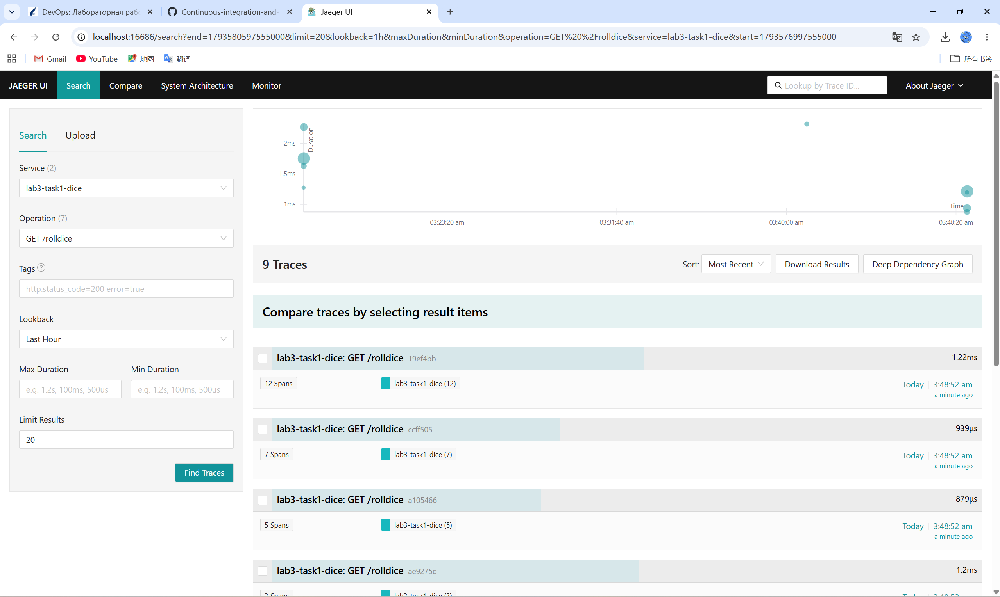
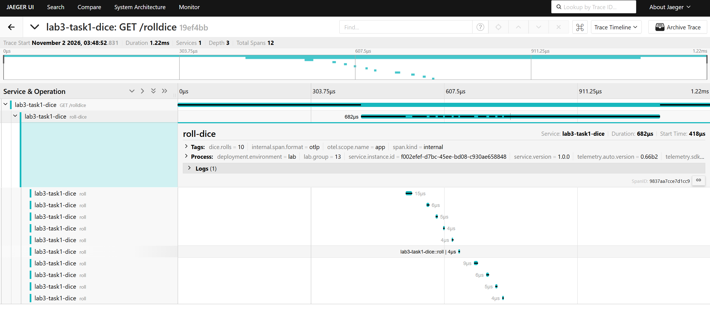

# Лабораторная работа №3 — Мониторинг в распределённых системах

## Задание 1. Подключение инструментов и библиотек OpenTelemetry и настройка трассировки приложения

Группа 13. Вариант: базовое Flask-приложение (пример OpenTelemetry «Getting Started by Example»)
с ручной и автоматической инструментацией трассировки, сбор трассировок в Jaeger.

## Overview

Приложение на Flask (`app.py`), упакованное в Docker-образ. Трассировка построена на
OpenTelemetry Python SDK:

* **автоматическая инструментация** — `opentelemetry-instrument` + `opentelemetry-instrumentation-flask`
  (автоматически создаёт спан на каждый HTTP-запрос);
* **ручная инструментация** — `trace.get_tracer(...)` создаёт вложенные спаны, атрибуты,
  события и статус ошибки;
* **экспорт** — OTLP/gRPC на `jaeger:4317`, приём и визуализация в Jaeger.

### Эндпоинты

| Метод | Путь        | Назначение                                                  |
|-------|-------------|-------------------------------------------------------------|
| GET   | `/`         | описание сервиса и список эндпоинтов                        |
| GET   | `/rolldice` | бросок кубика, параметр `rolls=N` (1…10), N дочерних спанов |
| GET   | `/error`    | ошибка 500: спан со статусом `ERROR` и записью исключения   |
| GET   | `/health`   | проверка работоспособности                                  |

### Структура репозитория

```
task1/
├── app.py                    # Flask-приложение с инструментацией
├── requirements.txt          # зависимости Python
├── Dockerfile                # образ приложения (шаг 5)
├── docker-compose.yaml       # приложение + Jaeger (шаги 4–5)
├── .dockerignore
├── .gitignore
├── scripts/
│   └── load.py               # генератор тестовой нагрузки
└── screenshots/
    ├── jaeger-trace-list.png   # список трассировок в Jaeger UI
    └── jaeger-trace-detail.png # детали трассировки (спаны, теги, события)
```

## Usage

### 1. Запуск стенда

```bash
cd task1
docker compose up -d --build
```

Поднимаются два контейнера:

| Контейнер            | Назначение                | Порты                                |
|----------------------|---------------------------|--------------------------------------|
| `lab3-task1-app`     | Flask-приложение          | `8080`                               |
| `lab3-task1-jaeger`  | Jaeger all-in-one (OTLP)  | `16686` (UI), `4317` (gRPC), `4318` (HTTP) |

### 2. Проверка работы

```bash
curl http://localhost:8080/rolldice?rolls=3
python scripts/load.py
```

### 3. Просмотр трассировок

Открыть <http://localhost:16686>, в поле **Service** выбрать `lab3-task1-dice`,
в поле **Operation** — `GET /rolldice`, нажать **Find Traces**.
В списке будут трассировки с дочерними спанами `roll`, а также `failing-operation`
со статусом ошибки (тег `error=true`).

### 4. Остановка

```bash
docker compose down
```

### Переменные окружения (задаются в `docker-compose.yaml`)

| Переменная                    | Значение                  | Назначение                          |
|-------------------------------|---------------------------|-------------------------------------|
| `OTEL_SERVICE_NAME`           | `lab3-task1-dice`         | имя сервиса в Jaeger                |
| `OTEL_TRACES_EXPORTER`        | `otlp`                    | экспортёр трассировок               |
| `OTEL_EXPORTER_OTLP_ENDPOINT` | `http://jaeger:4317`      | адрес OTLP-приёмника                |
| `OTEL_EXPORTER_OTLP_PROTOCOL` | `grpc`                    | протокол OTLP                       |
| `OTEL_METRICS_EXPORTER`       | `none`                    | метрики выключены (это задание 2)   |
| `OTEL_LOGS_EXPORTER`          | `none`                    | журналы выключены (это задание 3)   |
| `OTEL_RESOURCE_ATTRIBUTES`    | `...lab.group=13`         | ресурсные атрибуты сервиса          |
| `OTEL_PYTHON_LOG_CORRELATION` | `true`                    | связывание журналов с трассировкой  |

## Скриншоты

### Рис. 1. Список трассировок в Jaeger UI

Сервис `lab3-task1-dice`, операция `GET /rolldice`, период — последний час.
Найдено 9 трассировок; количество спанов (12, 7, 5, 3) соответствует параметру `rolls`,
длительность — от 0.88 мс до 2.32 мс.



### Рис. 2. Детали трассировки `19ef4bb`

1 сервис, глубина 3, всего 12 спанов: `GET /rolldice` → `roll-dice` → 10 × `roll`.
Для спана `roll-dice` раскрыты теги `dice.rolls=10`, `otel.scope.name=app`,
`span.kind=internal`, ресурсные атрибуты процесса (`deployment.environment=lab`,
`lab.group=13`, `service.version=1.0.0`) и событие `dice.rolled` в разделе Logs.



### Результаты проверки (кратко)

| Проверка | Результат |
|----------|-----------|
| `docker compose ps` | оба контейнера `Up`, приложение `(healthy)` |
| Эндпоинты `/`, `/rolldice`, `/health` | `200 OK` |
| `/error` | `500`, спан `error=true`, `otel.status_code=ERROR`, записан стектрейс |
| Операции в Jaeger | 7: 4 автоматические (server) + 3 ручные (internal) |
| Иерархия спанов | корректна, общий `traceID` у всех 12 спанов |

## Author

Цзэн Яосинь (ZENG YAOXIN), студент группы 13, ФПМИ БГУ.

## Additional Notes

Отчёт по лабораторной работе: [`../docs/report.md`](../docs/report.md).
